# Praktikum 6 – DOM dan Event JavaScript (Pemrograman Web)

| | |
|---|---|
| **Nama** | Riksa Siddiq Alrizki |
| **NIM** | 312510015 |
| **Kelas** | I253A |
| **Program Studi** | Teknik Informatika |
| **Mata Kuliah** | Pemrograman Web |
| **Universitas** | Universitas Pelita Bangsa |

---

## 1. Tujuan Praktikum

1. Memilih elemen HTML dan mengubah kontennya menggunakan DOM.
2. Menangani event (`click`, `input`, `change`, `submit`) dengan `addEventListener()`.
3. Mengubah kelas dan gaya CSS elemen melalui `classList`.
4. Membuat validasi form pendaftaran dengan JavaScript.
5. Membuat dan menambahkan elemen HTML secara dinamis (To-do List).
6. Membuat mini project form pendaftaran workshop dengan fungsi interaktif.

## 2. Struktur Folder

```
lab6_dom_event/
├── index.html      (halaman latihan)
├── style.css       (CSS latihan)
├── script.js       (JavaScript latihan)
├── mini_project/   (index.html, style.css, script.js)
├── screenshoot/    (1.png - 12.png)
└── README.md
```

Script dihubungkan dengan atribut `defer` agar dijalankan setelah seluruh HTML selesai dimuat.

```html
<script src="script.js" defer></script>
```

---

## 3. Latihan

### Latihan 1 – Mengubah teks dengan DOM

```javascript
const judul = document.getElementById("judul");
const pesan = document.getElementById("pesan");
judul.textContent = "Belajar JavaScript DOM";
pesan.textContent = "Konten berhasil diubah oleh JavaScript.";
```

**Penjelasan:**

- `document.getElementById("judul")` memilih elemen berdasarkan atribut `id`.
- Properti `textContent` dipakai untuk mengganti isi teks elemen tersebut.

**Hasil:** judul dan paragraf pada halaman berubah dari isi awal HTML menjadi teks yang diatur JavaScript. Sesuai instruksi modul, kalimat pada `pesan` kemudian diubah menjadi kalimat lain ("Konten berhasil diubah oleh Riksa Siddiq Alrizki.") dan halaman menampilkan kalimat yang baru.

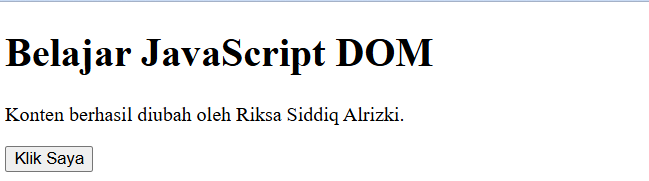

---

### Latihan 2 – Event click

```javascript
const tombol = document.getElementById("tombolAksi");
const pesan = document.getElementById("pesan");

tombol.addEventListener("click", function () {
  pesan.textContent = "Tombol diklik pada " + new Date().toLocaleTimeString();
});
```

**Penjelasan:**

- `addEventListener("click", ...)` menjalankan function setiap kali tombol diklik.
- `new Date().toLocaleTimeString()` mengambil waktu saat tombol ditekan dalam format jam setempat.

**Hasil:** setiap tombol **Klik Saya** ditekan, paragraf diperbarui dengan waktu klik terbaru.

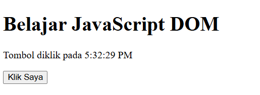

---

### Latihan 3 – Mengubah kelas dan gaya CSS

```css
.highlight {
  color: #173f75;
  background-color: #e6f1ff;
  border-left: 4px solid #3478c8;
  padding: 12px;
}
.teks-besar { font-size: 1.4rem; }
```

```javascript
const tombolGaya = document.getElementById("tombolGaya");
const teksGaya = document.getElementById("teksGaya");

tombolGaya.addEventListener("click", function () {
  teksGaya.classList.toggle("highlight");
  teksGaya.classList.toggle("teks-besar");
});
```

**Penjelasan:** `classList` dipakai untuk mengelola class CSS suatu elemen tanpa mengganti seluruh atribut `class`.

| Method | Fungsi |
|---|---|
| `classList.add("x")` | Menambahkan class `x` (jika sudah ada, tidak diduplikasi) |
| `classList.remove("x")` | Menghapus class `x` |
| `classList.toggle("x")` | Menambahkan class jika belum ada, dan menghapusnya jika sudah ada |

**Hasil:** saat tombol **Ubah Gaya** ditekan, paragraf mendapat latar biru muda, garis di sisi kiri, dan ukuran huruf lebih besar. Ketika tombol ditekan lagi, kedua class dilepas dan paragraf kembali ke tampilan biasa.

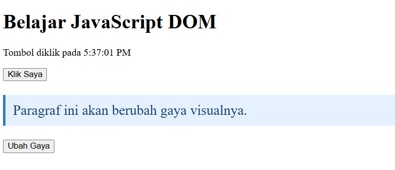

---

### Latihan 4 – Event input dan penghitung karakter

```html
<label for="namaInput">Nama:</label>
<input type="text" id="namaInput" maxlength="40">
<p>Jumlah karakter: <span id="jumlahKarakter">0</span></p>
```

```javascript
const namaInput = document.getElementById("namaInput");
const jumlahKarakter = document.getElementById("jumlahKarakter");

namaInput.addEventListener("input", function () {
  jumlahKarakter.textContent = namaInput.value.length;
});
```

**Penjelasan:** event `input` terjadi setiap kali isi kolom berubah (mengetik, menghapus, atau menempel teks). `namaInput.value.length` menghitung jumlah karakter, lalu hasilnya ditampilkan pada `<span id="jumlahKarakter">`. Atribut `maxlength="40"` membatasi input maksimal 40 karakter.

**Hasil:** mengetik "riksa" menampilkan "Jumlah karakter: 5".

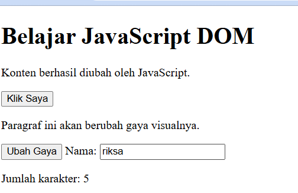

---

### Latihan 5 – Validasi form pendaftaran

```html
<form id="formPendaftaran" novalidate>
  <label for="nama">Nama lengkap</label>
  <input id="nama" name="nama" type="text">
  <label for="email">Email</label>
  <input id="email" name="email" type="email">
  <label for="usia">Usia</label>
  <input id="usia" name="usia" type="number" min="17" max="100">
  <button type="submit">Daftar</button>
</form>
<p id="pesanForm" aria-live="polite"></p>
```

```javascript
const form = document.getElementById("formPendaftaran");
const pesanForm = document.getElementById("pesanForm");

form.addEventListener("submit", function (event) {
  event.preventDefault();
  const nama = document.getElementById("nama").value.trim();
  const email = document.getElementById("email").value.trim();
  const usiaInput = document.getElementById("usia").value;
  const usia = Number(usiaInput);
  const polaEmail = /^[^\s@]+@[^\s@]+\.[^\s@]+$/;

  if (nama === "") {
    pesanForm.textContent = "Nama wajib diisi.";
  } else if (!polaEmail.test(email)) {
    pesanForm.textContent = "Masukkan email yang valid.";
  } else if (usiaInput === "" || !Number.isInteger(usia) || usia < 17 || usia > 100) {
    pesanForm.textContent = "Usia harus berupa bilangan bulat 17–100.";
  } else {
    pesanForm.textContent = "Validasi berhasil. Form siap diproses.";
    form.reset();
  }
});
```

**Penjelasan:**

- `novalidate` pada form menonaktifkan validasi bawaan browser agar validasi dilakukan oleh JavaScript.
- `event.preventDefault()` mencegah form dikirim dan halaman dimuat ulang.
- `trim()` menghapus spasi di awal dan akhir input.
- `polaEmail` adalah *regular expression* untuk memeriksa format email (ada teks, tanda `@`, dan domain).
- Setelah semua validasi lolos, `form.reset()` mengosongkan seluruh kolom.
- `aria-live="polite"` membuat pembaca layar membacakan pesan yang berubah.

**Kondisi pengujian dan pesan yang tampil sesuai kode:**

| Kondisi | Pesan |
|---|---|
| Semua kosong | Nama wajib diisi. |
| Nama kosong | Nama wajib diisi. |
| Email tidak valid | Masukkan email yang valid. |
| Usia di bawah 17 | Usia harus berupa bilangan bulat 17–100. |
| Semua input valid | Validasi berhasil. Form siap diproses. |

**Hasil:** pada pengujian dengan semua input valid, pesan keberhasilan tampil dan seluruh kolom otomatis dikosongkan.

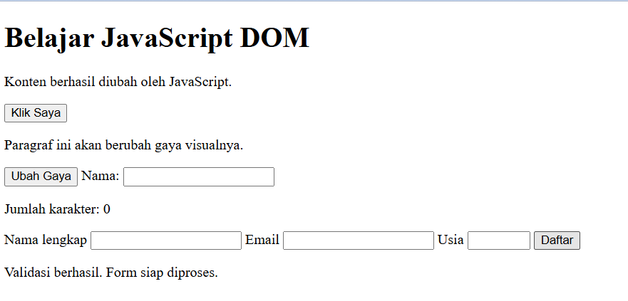

---

### Latihan 6 – Daftar tugas sederhana (To-do List)

```html
<section>
  <h2>Daftar Tugas</h2>
  <label for="inputTugas">Tugas baru</label>
  <input id="inputTugas" type="text">
  <button id="tambahTugas" type="button">Tambah</button>
  <p id="pesanTugas" aria-live="polite"></p>
  <ul id="daftarTugas"></ul>
</section>
```

```javascript
const inputTugas = document.getElementById("inputTugas");
const tambahTugas = document.getElementById("tambahTugas");
const daftarTugas = document.getElementById("daftarTugas");
const pesanTugas = document.getElementById("pesanTugas");

tambahTugas.addEventListener("click", function () {
  const teks = inputTugas.value.trim();
  if (teks === "") {
    pesanTugas.textContent = "Tulis tugas terlebih dahulu.";
    return;
  }
  const item = document.createElement("li");
  const label = document.createElement("span");
  const selesai = document.createElement("button");
  label.textContent = teks + " ";
  selesai.type = "button";
  selesai.textContent = "Tandai selesai";
  selesai.addEventListener("click", function () {
    item.classList.toggle("selesai");
    selesai.textContent = item.classList.contains("selesai")
      ? "Batalkan selesai" : "Tandai selesai";
  });
  item.append(label, selesai);
  daftarTugas.appendChild(item);
  inputTugas.value = "";
  pesanTugas.textContent = "Tugas ditambahkan.";
  inputTugas.focus();
});
```

```css
.selesai span { text-decoration: line-through; color: #687386; }
li { margin-bottom: 8px; }
```

**Penjelasan:**

- Saat tombol **Tambah** diklik, teks tugas diambil dan divalidasi. Jika kosong, ditampilkan pesan "Tulis tugas terlebih dahulu." lalu proses dihentikan dengan `return`.
- Elemen baru dibuat dengan `document.createElement()` (`li`, `span`, dan `button`), lalu digabungkan dengan `item.append(...)` dan dimasukkan ke daftar dengan `appendChild()`.
- Tombol **Tandai selesai** memakai `classList.toggle("selesai")` sehingga teks tugas dicoret, dan teks tombol berganti menjadi "Batalkan selesai".
- Teks pengguna dimasukkan lewat `textContent`, bukan `innerHTML`, sehingga ditampilkan sebagai teks biasa dan bukan sebagai markup HTML.

**Hasil:** dua tugas ditambahkan. Tugas kedua ("LaporanWeb6") sudah ditandai selesai sehingga tercoret dan tombolnya berubah menjadi "Batalkan selesai".

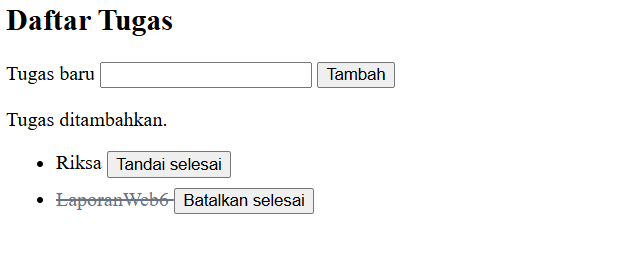

---

## 4. Mini Project – Form Pendaftaran Workshop

Mini project berupa halaman pendaftaran workshop yang kodenya dipisah menjadi tiga file, yaitu `index.html`, `style.css`, dan `script.js`. Fungsi interaktif yang diterapkan menggunakan `addEventListener()`:

| Fungsi | Event | Keterangan |
|---|---|---|
| Penghitung karakter nama | `input` | Menampilkan "Jumlah karakter: n/40" secara langsung saat mengetik |
| Pilihan sesi workshop | `change` | Memilih sesi pada dropdown |
| Pendaftaran | `submit` / `click` | Memeriksa input lalu menampilkan pesan hasil |
| Reset form | `click` | Tombol **Reset Form** mengosongkan input |
| Pesan hasil | – | Pesan kesalahan atau pesan sukses tampil pada halaman |

**Tampilan HTML sebelum diberi CSS:** form berisi kolom Nama Lengkap, Email, Pilihan Sesi Workshop, serta tombol **Daftar Workshop** dan **Reset Form**.

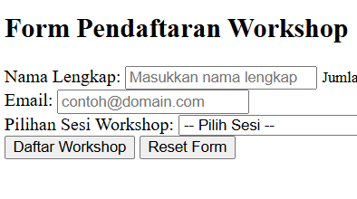

**Tampilan setelah diberi CSS dan JavaScript:** form diberi warna, jarak, dan kotak pesan. Pada contoh ini nama "riksa" dimasukkan (penghitung menampilkan 5/40), sesi **Front-End Web Development** dipilih, dan setelah tombol **Daftar Workshop** ditekan tampil kotak "Pendaftaran Berhasil!" yang merangkum nama, email, dan sesi.

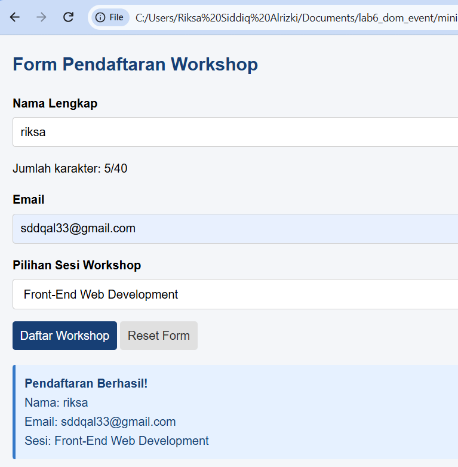

---

## 5. Eksperimen Mandiri

Kode pada bagian ini adalah contoh implementasi untuk menjelaskan cara kerja tiap eksperimen.

### Eksperimen 1 – Tombol hapus pada To-do List

```javascript
const hapus = document.createElement("button");
hapus.type = "button";
hapus.textContent = "Hapus";
hapus.addEventListener("click", function () {
  item.remove();
});
item.append(label, selesai, hapus);
```

**Penjelasan:** tombol **Hapus** dibuat bersama elemen `li` pada Latihan 6. Saat diklik, `item.remove()` menghapus satu item tugas dari daftar tanpa memengaruhi item lainnya.

**Hasil:** setiap item tugas kini memiliki tombol **Tandai selesai** dan **Hapus**.

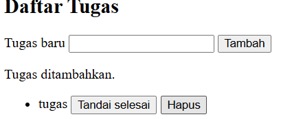

### Eksperimen 2 – Validasi nama minimal tiga karakter

```javascript
if (nama === "") {
  pesanForm.textContent = "Nama wajib diisi.";
} else if (nama.length < 3) {
  pesanForm.textContent = "Nama harus terdiri dari minimal 3 karakter.";
} else if (!polaEmail.test(email)) {
  // ... validasi berikutnya sama seperti sebelumnya
}
```

**Penjelasan:** ditambahkan satu kondisi `nama.length < 3` setelah pemeriksaan nama kosong dan sebelum pemeriksaan email.

**Hasil:** nama "ab" (2 karakter) ditolak dengan pesan "Nama harus terdiri dari minimal 3 karakter." meskipun email dan usia sudah valid.

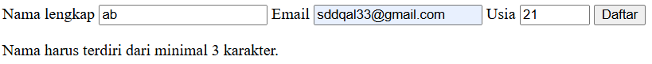

### Eksperimen 3 – Event change pada dropdown sesi workshop

```javascript
sesi.addEventListener("change", function () {
  info.textContent = sesi.value;   // sesi = elemen <select>, info = elemen penampil
});
```

**Penjelasan:** event `change` pada elemen `<select>` terjadi ketika pengguna memilih opsi yang berbeda. Nilai yang dipilih langsung ditampilkan pada halaman.

**Hasil:** setelah memilih "Front-End Web Development", halaman menampilkan "Sesi dipilih: Front-End Web Development". Sebelum ada pilihan, tampil "Belum ada sesi dipilih" (lihat Eksperimen 4).

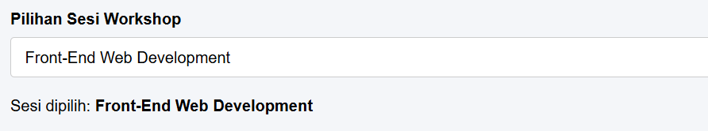

### Eksperimen 4 – Tombol sembunyikan dan tampilkan paragraf dengan class CSS

```css
.sembunyi { display: none; }
```

```javascript
tombolInfo.addEventListener("click", function () {
  paragrafInfo.classList.toggle("sembunyi");
});
```

**Penjelasan:** menyembunyikan elemen cukup dengan menambahkan class `sembunyi` (`display: none`) memakai `classList.toggle()`. Cara ini lebih rapi daripada mengubah `style.display` langsung karena tampilan diatur di CSS, sedangkan JavaScript hanya mengatur class.

**Hasil:** halaman dengan tombol **Sembunyikan Informasi** di bawah form, dan paragraf "Selamat datang di workshop pemrograman web!" di bagian atas.

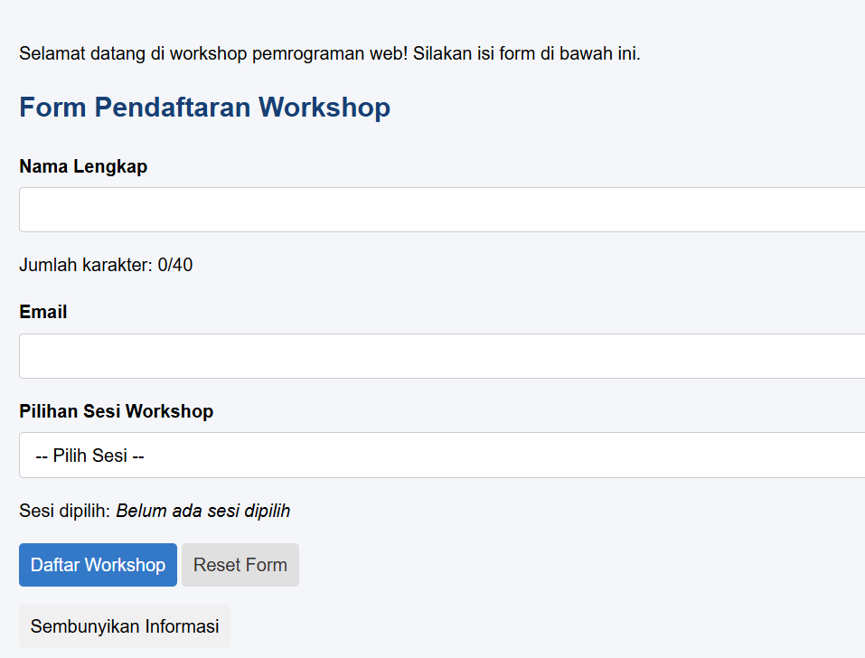

### Eksperimen 5 – Script tanpa `defer` di bagian `head`

Jika `<script src="script.js"></script>` (tanpa `defer`) diletakkan di `<head>`, browser menjalankan script sebelum elemen di `<body>` dibuat.

**Kemungkinan masalah:** pemanggilan seperti `document.getElementById("tombolAksi")` menghasilkan `null` karena elemennya belum ada di DOM. Akibatnya, baris berikutnya (misalnya `tombol.addEventListener(...)`) menimbulkan error `Cannot read properties of null` di Console, dan fitur interaktif tidak berjalan.

**Penyebab:** browser membaca HTML dari atas ke bawah. Script yang tidak memakai `defer` menghentikan proses pembacaan HTML dan langsung dieksekusi pada saat itu.

**Solusi:**

| Cara | Keterangan |
|---|---|
| `<script src="script.js" defer></script>` | Script diunduh paralel dan dijalankan setelah HTML selesai dibaca |
| Script diletakkan di akhir `<body>` | Elemen sudah tersedia saat script dijalankan |
| Membungkus kode dengan `DOMContentLoaded` | Kode baru berjalan setelah DOM siap |

---

## 6. Kesimpulan

Pada praktikum ini dipelajari cara JavaScript berinteraksi dengan halaman melalui DOM: memilih elemen dengan `getElementById`, mengubah isi dengan `textContent`, mengatur tampilan dengan `classList`, dan membuat elemen baru dengan `createElement`. Penanganan event dengan `addEventListener()` memungkinkan halaman merespons klik, input, perubahan pilihan, dan pengiriman form. Validasi form memerlukan `preventDefault()` untuk menahan pengiriman bawaan serta pemeriksaan input seperti `trim()` dan regular expression. Mini project form pendaftaran workshop menggabungkan penghitung karakter, dropdown sesi, pesan hasil, dan tombol reset menjadi halaman yang interaktif. Eksperimen mandiri menunjukkan bahwa penempatan script berpengaruh pada keberhasilan program, sehingga `defer` atau penempatan di akhir `body` perlu digunakan agar elemen sudah tersedia saat script dijalankan.
